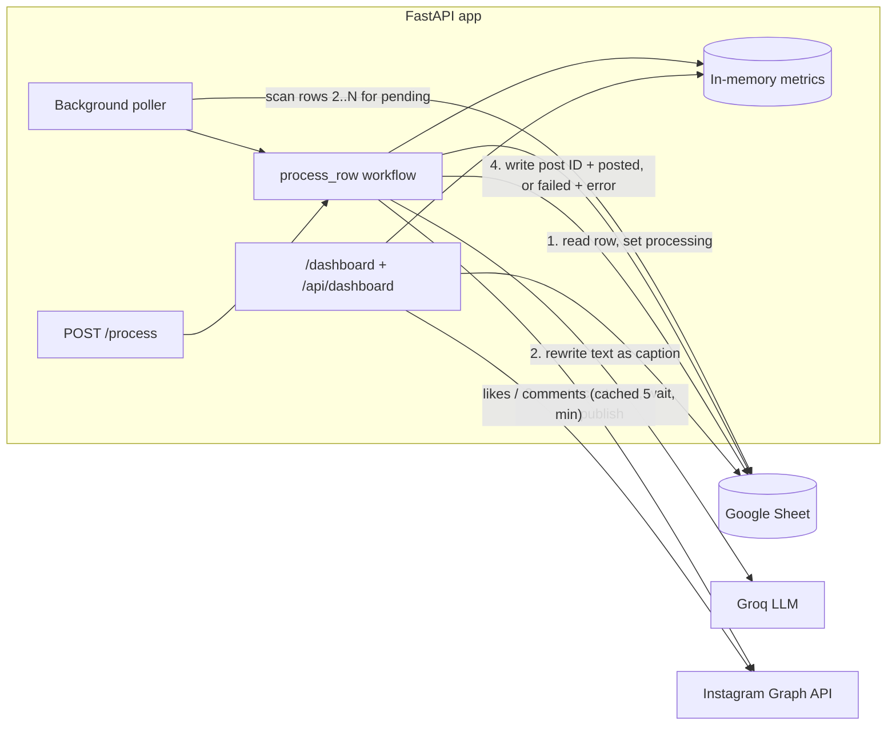

# Social Post Orchestrator

Write posts in a Google Sheet. The orchestrator turns each `pending` row into an Instagram caption with Groq, publishes the image and caption through the Instagram Graph API, and writes the result back to the sheet. A token-protected dashboard shows what happened.

- **Hands-off:** a background poller picks up pending rows every `POLLING_INTERVAL_SECONDS`.
- **On demand:** `POST /process` processes one row now.
- **Safe to retry:** transient errors (429, timeouts, 5xx) are retried with backoff. Permanent errors are written to the sheet.
- **Dry run:** run the whole flow without an Instagram account (`DRY_RUN=true`).
- **Dashboard:** `/dashboard` shows status totals, failures by stage, engagement, poller health, recent activity, and every row, with a "Process now" button.

## Architecture



## Sheet layout

Row 1 is the header. Columns are found by header name, so their order does not matter.

| Header (any of) | Purpose |
|---|---|
| `Status` | `pending`, `processing`, `posted` or `failed` (case and spaces ignored) |
| `Post Text` / `Text` | Raw text that Groq turns into a caption |
| `Image URL` / `Image` / `URL` | Public HTTPS image URL (JPEG) that Instagram downloads |
| `Instagram Post ID` / `Post ID` | Written by the app on success |
| `Error Log` / `Error` | Written by the app on failure as `<stage>: <message>` |

If the header cannot be read, the default order is `Status, Post Text, Instagram Post ID, Error Log, Image URL` (columns A to E).

### Status lifecycle

```
pending ──> processing ──> posted   (post ID written, error cleared)
                     └───> failed   (error written as "<stage>: <message>")
```

Stages: `llm_transform`, `instagram_container`, `instagram_publish`, `unknown`.

Rows with any other status, or an empty status, are skipped.

**To retry a failed row,** fix the cause, then set its status back to `pending`. The poller picks it up on the next scan, or you can click "Process now" in the dashboard.

**A row stuck in `processing`** means a run did not finish: the server stopped mid-run, or the sheet write at the end failed. The post may already be live. Check the Instagram account before you set the row back to `pending`, or you will publish it twice. If the post went out but the sheet write failed, the error column says `sheet_update: published as <id> …` and the server log has the post ID.

**A row failed at stage `instagram_publish` with "Publish outcome unknown"** means the publish request got no response or an HTTP 5xx error (or a retry after one of those was rejected), and the app could not confirm whether the post went through. Before any retry it checks the container: if it is already published, it does not post again. It does not retry on its own. Check the Instagram account first; only set the row back to `pending` if the post is not there. (If the app could confirm the post is live but not its ID, the row is marked `posted` with the ID `published-id-unknown-<container>` and a note in the error column.)

## Setup

### 1. Google service account

1. In [Google Cloud Console](https://console.cloud.google.com/), create a project and enable the **Google Sheets API**.
2. Create a **service account** (IAM & Admin > Service Accounts), then create a **JSON key** for it.
3. From the JSON key, copy `client_email` to `GOOGLE_SERVICE_ACCOUNT_EMAIL` and `private_key` to `GOOGLE_PRIVATE_KEY`. Keep the `\n` sequences and wrap the value in double quotes.
4. Open your spreadsheet, click **Share**, and add the service account email as an **Editor**. Without this step every read fails with 403.
5. Copy the spreadsheet ID from the URL (`https://docs.google.com/spreadsheets/d/<ID>/edit`) to `GOOGLE_SPREADSHEET_ID`.

### 2. Instagram account ID and page access token

Publishing needs an Instagram **Business or Creator** account linked to a **Facebook Page**.

1. In Instagram settings, switch to a Professional account and link it to a Facebook Page.
2. Create an app at [developers.facebook.com](https://developers.facebook.com/) and add the **Instagram Graph API** product.
3. In the [Graph API Explorer](https://developers.facebook.com/tools/explorer/), select your app and request the permissions `instagram_basic`, `instagram_content_publish`, `pages_show_list` and `pages_read_engagement`. Generate a user token.
4. Call `GET /me/accounts`. Copy the page's `access_token` to `FACEBOOK_PAGE_ACCESS_TOKEN`. For a long-lived token, exchange it first (see Meta's "long-lived access tokens" docs).
5. Call `GET /<page-id>?fields=instagram_business_account`. Copy the `id` to `INSTAGRAM_ACCOUNT_ID`.

No Instagram account? Set `DRY_RUN=true`.

### 3. Groq

Create a key at [console.groq.com/keys](https://console.groq.com/keys) and set `GROQ_API_KEY`.

## Configuration

Copy `.env.example` to `.env` and fill it in. Every setting can also be passed as an environment variable.

| Variable | Default | Description |
|---|---|---|
| `INTERNAL_TOKEN` | required | Shared secret for `POST /process` and the dashboard (`X-Internal-Token` header) |
| `GOOGLE_SERVICE_ACCOUNT_EMAIL` | `""` | Service account email |
| `GOOGLE_PRIVATE_KEY` | `""` | Service account private key (`\n`-escaped) |
| `GOOGLE_SPREADSHEET_ID` | `""` | Spreadsheet ID |
| `GOOGLE_SHEET_NAME` | `Sheet1` | Worksheet tab name |
| `GROQ_API_KEY` | required | Groq API key |
| `GROQ_MODEL` | `llama-3.3-70b-versatile` | Groq model for captions |
| `GROQ_TIMEOUT_SECONDS` | `20` | Groq request timeout |
| `GROQ_MAX_RETRIES` | `1` | Retries after a transient Groq error |
| `INSTAGRAM_ACCOUNT_ID` | `""` | Instagram Business account ID |
| `FACEBOOK_PAGE_ACCESS_TOKEN` | `""` | Page access token |
| `INSTAGRAM_GRAPH_API_VERSION` | `v25.0` | Graph API version |
| `INSTAGRAM_TIMEOUT_SECONDS` | `30` | Instagram request timeout |
| `INSTAGRAM_MAX_RETRIES` | `3` | Retries after a transient Instagram error |
| `DRY_RUN` | `false` | Skip all Instagram calls; post IDs become `dry-run-…` |
| `API_RATE_LIMIT_MAX_REQUESTS` | `5` | `POST /process` requests per client IP per window |
| `API_RATE_LIMIT_WINDOW_SECONDS` | `60` | Rate-limit window |
| `POLLING_ENABLED` | `true` | Run the background poller |
| `POLLING_INTERVAL_SECONDS` | `60` | Seconds between scans |
| `POLLING_MAX_ROWS` | `100` | Scan rows 2..N (also bounds the dashboard) |

If the Google settings are empty, the poller logs one warning and stays off. The API and dashboard still run.

## Run locally

Requires Python 3.11.

```bash
# with uv
uv venv -p python3.11 .venv
uv pip install -p .venv -r requirements.txt
cp .env.example .env   # then edit .env
.venv/bin/uvicorn app.main:app --reload --port 8000

# or with venv + pip
python3.11 -m venv .venv
.venv/bin/pip install -r requirements.txt
.venv/bin/uvicorn app.main:app --reload --port 8000
```

Open <http://localhost:8000/dashboard> or the API docs at <http://localhost:8000/docs>.

### Dry run (no Instagram account needed)

```bash
DRY_RUN=true .venv/bin/uvicorn app.main:app --port 8000
```

The sheet is read and updated and Groq writes real captions. The Instagram step is skipped: rows end as `posted` with an ID like `dry-run-3f9c…`.

## Docker

```bash
cp .env.example .env   # then edit .env
docker compose up --build
```

The image runs as a non-root user and has a `HEALTHCHECK` on `/health`. All configuration comes from `.env`; no key files are mounted.

### Behind a reverse proxy

The rate limiter keys on the TCP peer address only. It ignores `X-Forwarded-For` and `X-Real-IP`, because any client can forge them. Behind a trusted proxy, let uvicorn rewrite the client address:

```bash
uvicorn app.main:app --host 0.0.0.0 --port 8000 --proxy-headers --forwarded-allow-ips="<proxy ip>"
```

## API

```bash
# Health (no auth)
curl http://localhost:8000/health
# {"status":"OK","polling_enabled":true,"dry_run":false}

# Process one row now (row 1 is the header, so row_id >= 2)
curl -X POST http://localhost:8000/process \
  -H "Content-Type: application/json" \
  -H "X-Internal-Token: $INTERNAL_TOKEN" \
  -d '{"row_id": 2}'
# {"status":"posted","row_id":2,"instagram_post_id":"17900000000000000"}
# {"row_id":2,"status":"failed","stage":"llm_transform","error":"Groq API error (HTTP 401)"}
# {"status":"ignored","row_id":2,"message":"Row status is 'posted', not pending"}
```

| Status | Meaning |
|---|---|
| 401 | Missing or wrong `X-Internal-Token` |
| 422 | Invalid body, for example `row_id` < 2 |
| 429 | Rate limited; see the `Retry-After` header |

## Dashboard

Open <http://localhost:8000/dashboard> (`/` redirects there) and enter `INTERNAL_TOKEN`. The token stays in this browser tab's `sessionStorage` and is sent as `X-Internal-Token`. **Sign out** clears it. A rejected token returns you to the login card.

It shows:

- **KPIs:** total rows, posted, failed, pending and success rate (posted / (posted + failed)).
- **Status breakdown** donut and **failures by stage** bars, parsed from the error column.
- **Pipeline and poller:** Sheet, Groq and Instagram state, last and next scan, uptime, runs since start, average run time.
- **Engagement:** likes and comments for the 12 most recent real posts, with links to Instagram. Cached for 5 minutes. Hidden in dry-run mode.
- **Recent activity:** the last 50 runs since the server started.
- **Sheet rows:** filterable by status, with errors and a **Process now** button on pending rows.

The page refreshes every 30 seconds and has a manual refresh button. It is a single HTML file with no external scripts, styles or fonts, and supports light and dark mode and phone-width screens. The JSON behind it is `GET /api/dashboard` (same token). It never includes secrets. Runtime metrics are in memory and reset on restart.

## Tests

```bash
uv pip install -p .venv -r requirements-dev.txt   # or: .venv/bin/pip install -r requirements-dev.txt
.venv/bin/python -m pytest -q
```

Tests need no `.env` and no network. Google Sheets, Groq and Instagram are mocked, and sleeps are patched out. CI runs the same command on Python 3.11 for every push and pull request (`.github/workflows/ci.yml`).
